# Práctica Zabbix: SNMP y DHCP con Router, Switch y Servidor

**Omar Paulino - Matrícula 20251325**

## Video de demostración

[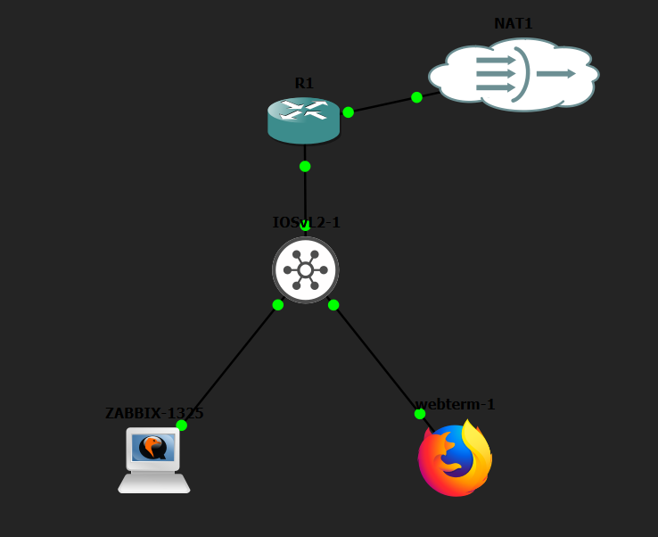](ENLACE_DEL_VIDEO)

**Enlace al video:** ENLACE_DEL_VIDEO

---

## Contenido

1. [Propósito del laboratorio](#1-propósito-del-laboratorio)
2. [Topología](#2-topología)
3. [Direccionamiento IP](#3-direccionamiento-ip)
4. [Equipos, credenciales y datos del laboratorio](#4-equipos-credenciales-y-datos-del-laboratorio)
5. [Router R1-1325](#5-router-r1-1325)
6. [Switch SW-1325](#6-switch-sw-1325)
7. [Servidor ZABBIX-1325](#7-servidor-zabbix-1325)
8. [Agregar el router y el switch en Zabbix](#8-agregar-el-router-y-el-switch-en-zabbix)
9. [Pruebas y resultados](#9-pruebas-y-resultados)
10. [Running-configs y scripts](#10-running-configs-y-scripts)

---

## 1. Propósito del laboratorio

El objetivo de esta práctica es monitorear los equipos de red de forma centralizada. El router reparte direcciones IP por DHCP en la LAN, el router y el switch publican su información por SNMP con una comunidad de **solo lectura**, y un servidor **Zabbix**, que recibe su propia IP por DHCP, consulta esa información y la muestra en su interfaz web: disponibilidad, tráfico de las interfaces, CPU, memoria, temperatura e inventario.

### Requisitos y cómo los cumplí

| Requisito | Cómo lo cumplí |
|---|---|
| Direccionamiento IP en router y switch | R1-1325 con Gi1/0 `10.13.25.1/24` como gateway de la LAN y Gi0/0 por DHCP hacia internet. SW-1325 con la interfaz de gestión `Vlan13` en `10.13.25.2/24` |
| Servidor DHCP para la red LAN | Pool `LAN-1325` en el router: red `10.13.25.0/24`, gateway `10.13.25.1`, DNS `8.8.8.8` y `1.1.1.1`, dominio `omar1325.local`, lease de 7 días, con `.1` a `.20` excluidas para los equipos con IP fija |
| Comunidad SNMP de solo lectura | `snmp-server community ZBX1325-RO RO SNMP-ZABBIX` en el router y el switch. La ACL `SNMP-ZABBIX` solo permite consultas desde la LAN y registra cualquier otro intento |
| Servidor Zabbix como cliente DHCP | Ubuntu 24.04 con `dhcp4: true` en netplan. Recibió `10.13.25.21` del router (`dynamic` en `ip a`, y su entrada en `show ip dhcp binding`) |
| Verificar los datos SNMP en Zabbix del router y del switch | Zabbix 7.0 con la plantilla *Cisco IOS by SNMP*. Los dos hosts tienen la etiqueta **SNMP en verde** y muestran datos en *Latest data*, gráficas e inventario |

---

## 2. Topología

### Topología en GNS3


| Nodo en GNS3 | Hostname | Plantilla |
|---|---|---|
| NAT1 | NAT-1325 | Nodo NAT de GNS3 |
| R1 | R1-1325 | Cisco c7200 |
| IOSvL2-1 | SW-1325 | Cisco IOSvL2 |
| ZABBIX-1325 | zabbix-1325 | Ubuntu Cloud Guest 24.04 LTS (Noble Numbat) |
| webterm-1 | webterm-1 | webterm (contenedor con Firefox) |

### Diagrama lógico

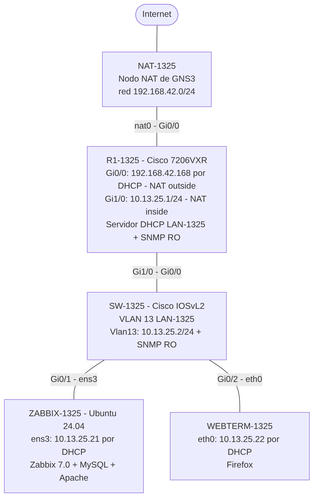

Toda la LAN está en la red `10.13.25.0/24` (VLAN 13). El router es el gateway, el servidor DHCP y el punto de salida a internet: hace NAT de la LAN hacia el nodo NAT de GNS3, que le da a Gi0/0 una IP de la red `192.168.42.0/24`. La salida a internet la necesité para descargar Zabbix en el servidor.

### Cómo recibe su IP el servidor Zabbix (DHCP)

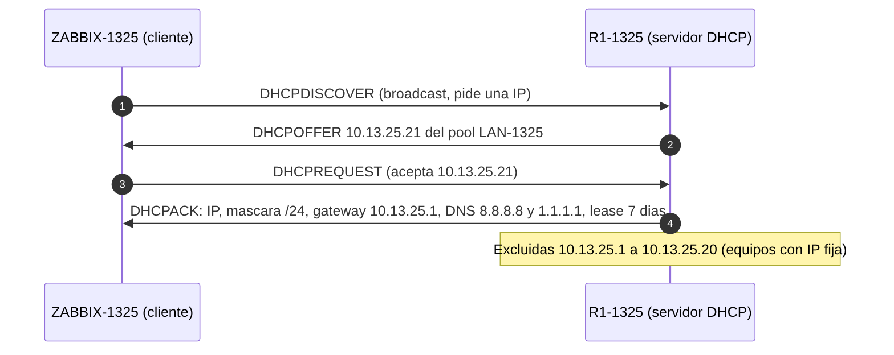

1. Al arrancar, el Ubuntu envía un **DHCPDISCOVER** por broadcast.
2. El router responde con un **DHCPOFFER** del pool `LAN-1325`.
3. El Ubuntu acepta la oferta con un **DHCPREQUEST**.
4. El router confirma con un **DHCPACK** que incluye la IP, la máscara, el gateway, los DNS y el tiempo de arrendamiento.

### Cómo monitorea Zabbix al router y al switch (SNMP)

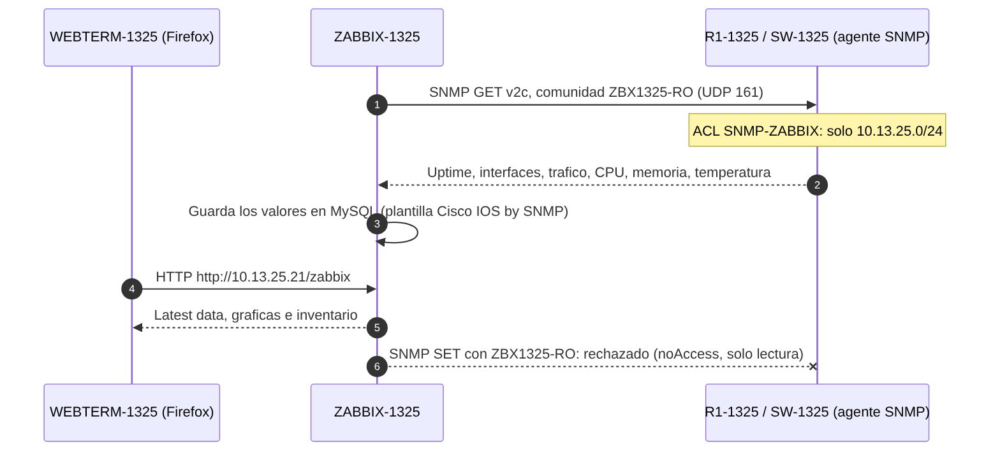

1. El servidor Zabbix consulta por **SNMPv2c** (UDP 161) a cada equipo con la comunidad `ZBX1325-RO`.
2. El equipo comprueba que la consulta viene de la LAN (ACL `SNMP-ZABBIX`) y responde con los datos pedidos.
3. Zabbix guarda los valores en su base de datos MySQL.
4. Desde el webterm abro la web de Zabbix y veo los datos, las gráficas y el inventario.
5. Si alguien intenta **cambiar** algo con esa comunidad (SNMP SET), el equipo lo rechaza, porque la comunidad es de solo lectura.

---

## 3. Direccionamiento IP

La red de la LAN se basa en mi matrícula 2025**1325**: los cuatro últimos dígitos forman la red `10.13.25.0/24`, y la VLAN es la **13**.

| Equipo | Interfaz | Dirección IP | Gateway | Cómo la obtiene |
|---|---|---|---|---|
| R1-1325 | Gi0/0 (hacia internet) | 192.168.42.168/24 | El del nodo NAT | DHCP del nodo NAT |
| R1-1325 | Gi1/0 (LAN) | 10.13.25.1/24 | No aplica | Fija |
| SW-1325 | Vlan13 | 10.13.25.2/24 | 10.13.25.1 | Fija |
| ZABBIX-1325 | ens3 | 10.13.25.21/24 | 10.13.25.1 | **DHCP del router** |
| WEBTERM-1325 | eth0 | 10.13.25.22/24 | 10.13.25.1 | **DHCP del router** |

### Cableado

| Origen | Puerto | Destino | Puerto |
|---|---|---|---|
| R1-1325 | Gi0/0 | NAT-1325 | nat0 |
| R1-1325 | Gi1/0 | SW-1325 | Gi0/0 |
| SW-1325 | Gi0/1 | ZABBIX-1325 | ens3 (Ethernet0 en GNS3) |
| SW-1325 | Gi0/2 | WEBTERM-1325 | eth0 |

### VLAN del switch

| VLAN | Nombre | Puertos |
|---|---|---|
| 13 | LAN-1325 | Gi0/0, Gi0/1, Gi0/2 |
| 999 | SIN-USO | Gi0/3, Gi1/0 a Gi1/3 (apagados) |

### Servidor DHCP

| Parámetro | Valor |
|---|---|
| Pool | LAN-1325 |
| Red | 10.13.25.0/24 |
| Gateway | 10.13.25.1 |
| DNS | 8.8.8.8 y 1.1.1.1 |
| Dominio | omar1325.local |
| Lease | 7 días |
| IPs excluidas | 10.13.25.1 a 10.13.25.20 (equipos con IP fija) |
| Rango que se reparte | 10.13.25.21 a 10.13.25.254 |

---

## 4. Equipos, credenciales y datos del laboratorio

| Equipo | Plataforma | Software | Recursos |
|---|---|---|---|
| R1-1325 | Cisco 7206VXR (Dynamips) | IOS 15.2(4)S6 ADVENTERPRISEK9 | 512 MB de RAM, slot0 C7200-IO-GE-E, slot1 PA-GE |
| SW-1325 | Cisco IOSvL2 (QEMU) | vios_l2 15.2 | Por defecto |
| ZABBIX-1325 | Ubuntu Cloud Guest (QEMU) | Ubuntu 24.04 LTS, Zabbix 7.0.32, MySQL 8.0, Apache | 2048 MB de RAM, 2 vCPU, disco ampliado 10 GB |
| WEBTERM-1325 | Contenedor Docker | Debian con Firefox | Por defecto |

| Dato | Valor |
|---|---|
| Comunidad SNMP (solo lectura) | `ZBX1325-RO` |
| Versión de SNMP | SNMPv2c |
| ACL de SNMP | `SNMP-ZABBIX` (solo 10.13.25.0/24) |
| Usuario local de los equipos Cisco | `admin1325` / `Local#1325` |
| Enable secret | `Enable#1325` |
| Base de datos de Zabbix | base `zabbix`, usuario `Omarpaulino` / `Zabbix#1325` |
| Web de Zabbix | `http://10.13.25.21/zabbix`, usuario `Admin` |
| Usuario del Ubuntu | `ubuntu` |

---

## 5. Router R1-1325

Toda la configuración está en [`scripts/router/R1-1325_configuracion.txt`](ZABBIX-SNMP-DHCP/scripts/router/R1-1325_configuracion.txt). A continuación la explico por partes.

### 5.1 Configuración básica

```
enable
configure terminal
hostname R1-1325
no ip domain-lookup
ip domain-name omar1325.local
service password-encryption
service timestamps log datetime msec localtime
clock timezone AST -4 0
enable secret Enable#1325
username admin1325 privilege 15 secret Local#1325
banner motd ^
*** R1-1325 - Practica Zabbix SNMP - Omar Paulino 20251325 ***
^
line con 0
 logging synchronous
 login local
exit
```

### 5.2 Interfaces (direccionamiento IP)

```
interface GigabitEthernet0/0
 description HACIA-INTERNET-NAT-1325
 ip address dhcp
 ip nat outside
 ip tcp adjust-mss 1360
 no shutdown
exit
interface GigabitEthernet1/0
 description LAN-1325-HACIA-SW-1325
 ip address 10.13.25.1 255.255.255.0
 ip nat inside
 ip tcp adjust-mss 1360
 no shutdown
exit
```

| Interfaz | Función |
|---|---|
| Gi0/0 | Salida a internet. Recibe su IP y la ruta por defecto del nodo NAT de GNS3 (`ip address dhcp`) |
| Gi1/0 | Gateway de la LAN `10.13.25.0/24` |
| `ip tcp adjust-mss 1360` | Ajusta el tamaño de los segmentos TCP que pasan por el router, para que las descargas grandes (como los paquetes de Zabbix) no se fragmenten al atravesar los dos NAT |

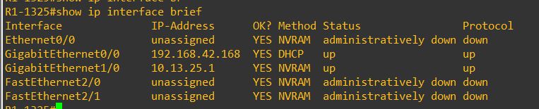

Gi0/0 tiene `192.168.42.168` asignada por DHCP (columna *Method*: DHCP) y Gi1/0 tiene `10.13.25.1`, las dos en `up/up`.

### 5.3 NAT para que la LAN salga a internet

```
ip access-list standard NAT-LAN-1325
 permit 10.13.25.0 0.0.0.255
exit
ip nat inside source list NAT-LAN-1325 interface GigabitEthernet0/0 overload
ip name-server 8.8.8.8
```

El router traduce las direcciones de la LAN a la IP de Gi0/0 (PAT, con `overload`). Así el servidor Zabbix pudo descargar los paquetes de Ubuntu y de Zabbix desde internet.

### 5.4 Servidor DHCP de la LAN

```
ip dhcp excluded-address 10.13.25.1 10.13.25.20
ip dhcp pool LAN-1325
 network 10.13.25.0 255.255.255.0
 default-router 10.13.25.1
 dns-server 8.8.8.8 1.1.1.1
 domain-name omar1325.local
 lease 7
exit
```

| Comando | Para qué sirve |
|---|---|
| `ip dhcp excluded-address` | El router no reparte de `.1` a `.20`, que quedan para equipos con IP fija (router y switch) |
| `network` | La red que se reparte |
| `default-router` | El gateway que reciben los clientes |
| `dns-server` | Los DNS que reciben los clientes |
| `domain-name` | El dominio que reciben los clientes |
| `lease 7` | Cada IP se presta por 7 días |

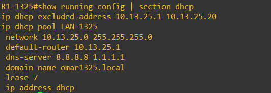

### 5.5 SNMP de solo lectura

```
ip access-list standard SNMP-ZABBIX
 permit 10.13.25.0 0.0.0.255
 deny   any log
exit
snmp-server community ZBX1325-RO RO SNMP-ZABBIX
snmp-server location Laboratorio-GNS3-20251325
snmp-server contact Omar-Paulino-20251325
snmp-server ifindex persist
end
write memory
```

| Comando | Para qué sirve |
|---|---|
| `snmp-server community ZBX1325-RO RO` | Crea la comunidad de **solo lectura**: con ella se puede consultar el equipo, pero no cambiar nada |
| `SNMP-ZABBIX` al final de la comunidad | Solo la LAN puede usar esa comunidad. Cualquier otro origen se rechaza y queda en el log (`deny any log`) |
| `location` / `contact` | Datos que Zabbix lee por SNMP y muestra en el inventario |
| `ifindex persist` | Los índices SNMP de las interfaces no cambian al reiniciar, así Zabbix no pierde el historial de cada interfaz. En el running-config aparece como `snmp ifmib ifindex persist` |

La ACL permite toda la red `10.13.25.0/24` y no solo la IP del servidor, porque el servidor Zabbix recibe su IP por DHCP y podría cambiar.

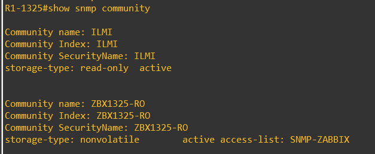

La comunidad `ZBX1325-RO` aparece activa y asociada a la ACL `SNMP-ZABBIX`. La comunidad `ILMI` es interna del IOS y viene por defecto.

---

## 6. Switch SW-1325

Toda la configuración está en [`scripts/switch/SW-1325_configuracion.txt`](ZABBIX-SNMP-DHCP/scripts/switch/SW-1325_configuracion.txt).

### 6.1 Configuración básica

```
enable
configure terminal
hostname SW-1325
no ip domain-lookup
ip domain-name omar1325.local
service password-encryption
service timestamps log datetime msec localtime
clock timezone AST -4 0
enable secret Enable#1325
username admin1325 privilege 15 secret Local#1325
banner motd ^
*** SW-1325 - Practica Zabbix SNMP - Omar Paulino 20251325 ***
^
line con 0
 logging synchronous
 login local
exit
```

### 6.2 VLAN y puertos

```
vlan 13
 name LAN-1325
vlan 999
 name SIN-USO
exit
interface GigabitEthernet0/0
 description HACIA-R1-1325-Gi1/0
 switchport mode access
 switchport access vlan 13
 spanning-tree portfast edge
 no shutdown
exit
interface GigabitEthernet0/1
 description ZABBIX-1325
 switchport mode access
 switchport access vlan 13
 spanning-tree portfast edge
 no shutdown
exit
interface GigabitEthernet0/2
 description WEBTERM-1325
 switchport mode access
 switchport access vlan 13
 spanning-tree portfast edge
 no shutdown
exit
interface range GigabitEthernet0/3, GigabitEthernet1/0 - 3
 description SIN-USO
 switchport mode access
 switchport access vlan 999
 shutdown
exit
```

Los tres puertos en uso están en la VLAN 13, en modo acceso y con `portfast`, para que los clientes DHCP reciban su IP sin esperar a que spanning-tree habilite el puerto. Los puertos libres están en la VLAN 999 y apagados.

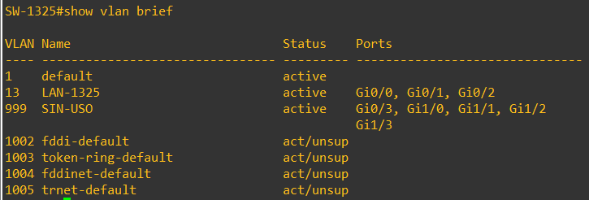

### 6.3 IP de gestión (direccionamiento IP)

El switch necesita una IP propia para que Zabbix lo pueda consultar por SNMP.

```
interface Vlan1
 shutdown
exit
interface Vlan13
 description GESTION-SW-1325
 ip address 10.13.25.2 255.255.255.0
 no shutdown
exit
ip default-gateway 10.13.25.1
ip route 0.0.0.0 0.0.0.0 10.13.25.1
```

Puse las dos líneas de salida porque el IOSvL2 trae el enrutamiento IP activado, y en ese caso ignora `ip default-gateway`. La ruta por defecto `ip route 0.0.0.0 0.0.0.0 10.13.25.1` funciona en los dos casos y permite que el switch llegue fuera de su red.

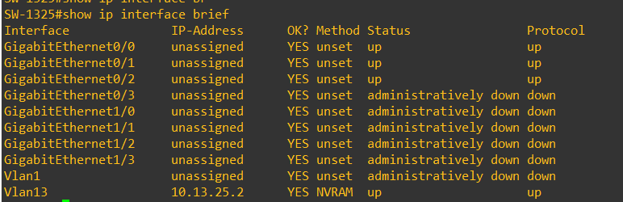

`Vlan13` tiene `10.13.25.2` en `up/up`, Gi0/0 a Gi0/2 están activos y los puertos sin uso están `administratively down`.

### 6.4 SNMP de solo lectura

```
ip access-list standard SNMP-ZABBIX
 permit 10.13.25.0 0.0.0.255
 deny   any log
exit
snmp-server community ZBX1325-RO RO SNMP-ZABBIX
snmp-server location Laboratorio-GNS3-20251325
snmp-server contact Omar-Paulino-20251325
snmp-server ifindex persist
end
write memory
```

Es la misma configuración del router, con la misma comunidad y la misma ACL.

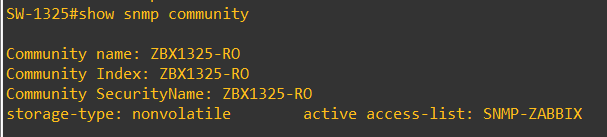

---

## 7. Servidor ZABBIX-1325

El servidor es la imagen **Ubuntu Cloud Guest 24.04** de GNS3, conectada directamente al puerto Gi0/1 del switch. En GNS3 le asigné 2048 MB de RAM y 2 vCPU, y amplié su disco 10 GB (`qemu-img resize hda_disk.qcow2 +10G` desde la GNS3 VM), porque la imagen trae un disco pequeño para Zabbix y MySQL.

Los scripts están en [`scripts/servidor/`](ZABBIX-SNMP-DHCP/scripts/servidor).

### 7.1 Cliente DHCP

Script: [`01_verificar_dhcp.sh`](ZABBIX-SNMP-DHCP/scripts/servidor/01_verificar_dhcp.sh)

La red del Ubuntu se configura con netplan. La interfaz `ens3` tiene `dhcp4: true`, así que pide su IP al router al arrancar. No configuré ninguna IP fija.

```yaml
network:
  version: 2
  ethernets:
    ens3:
      match:
        macaddress: "0c:bf:bf:1b:00:00"
      dhcp4: true
      dhcp6: true
      set-name: "ens3"
```

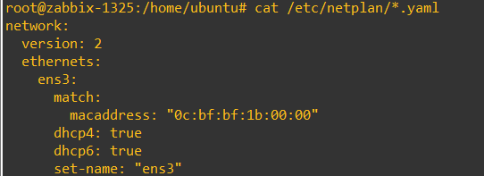

```
ip -4 a show ens3
```

La palabra **`dynamic`** confirma que la dirección `10.13.25.21/24` fue asignada por DHCP. `valid_lft 604144sec` es el tiempo que le queda al lease: unos 7 días, que es el `lease 7` del pool.

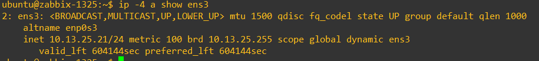

También cambié el nombre del equipo y la zona horaria:

```
sudo hostnamectl set-hostname zabbix-1325
sudo timedatectl set-timezone America/Santo_Domingo
sudo apt update && sudo apt upgrade -y
```

### 7.2 Instalación de Zabbix 7.0 LTS

Script: [`02_instalar_zabbix.sh`](ZABBIX-SNMP-DHCP/scripts/servidor/02_instalar_zabbix.sh)

Instalé Zabbix desde el repositorio oficial, como root (`sudo -i`):

```
wget https://repo.zabbix.com/zabbix/7.0/ubuntu/pool/main/z/zabbix-release/zabbix-release_latest_7.0+ubuntu24.04_all.deb
dpkg -i zabbix-release_latest_7.0+ubuntu24.04_all.deb
apt update
apt install -y zabbix-server-mysql zabbix-frontend-php zabbix-apache-conf zabbix-sql-scripts zabbix-agent mysql-server snmp
```

| Paquete | Qué es |
|---|---|
| `zabbix-server-mysql` | El servidor Zabbix: hace las consultas SNMP y guarda los datos |
| `zabbix-frontend-php` + `zabbix-apache-conf` | La interfaz web, servida por Apache |
| `zabbix-sql-scripts` | El esquema de la base de datos |
| `zabbix-agent` | Agente para que Zabbix se monitoree a sí mismo |
| `mysql-server` | La base de datos donde se guardan los valores |
| `snmp` | Los comandos `snmpwalk`, `snmpget` y `snmpset`, para probar SNMP a mano |

### 7.3 Base de datos

Script: [`03_base_de_datos.sql`](ZABBIX-SNMP-DHCP/scripts/servidor/03_base_de_datos.sql)

Dentro de `mysql`:

```sql
create database zabbix character set utf8mb4 collate utf8mb4_bin;
create user Omarpaulino@localhost identified by 'Zabbix#1325';
grant all privileges on zabbix.* to Omarpaulino@localhost;
set global log_bin_trust_function_creators = 1;
quit;
```

El usuario de la base de datos se llama `Omarpaulino` y solo puede conectarse desde el propio servidor (`@localhost`), así MySQL no queda expuesto en la red.

### 7.4 Esquema, conexión y servicios

Script: [`04_configurar_e_iniciar.sh`](ZABBIX-SNMP-DHCP/scripts/servidor/04_configurar_e_iniciar.sh)

```
zcat /usr/share/zabbix-sql-scripts/mysql/server.sql.gz | mysql --default-character-set=utf8mb4 -uOmarpaulino -p zabbix
mysql -e "set global log_bin_trust_function_creators = 0;"
```

En `/etc/zabbix/zabbix_server.conf` indiqué el usuario y la contraseña de la base de datos:

```
DBName=zabbix
DBUser=Omarpaulino
DBPassword=Zabbix#1325
```

El archivo completo, sin comentarios, está en [`running-configs/zabbix_server.conf`](ZABBIX-SNMP-DHCP/running-configs/zabbix_server.conf).

```
zabbix_server -c /etc/zabbix/zabbix_server.conf -T
systemctl restart zabbix-server zabbix-agent apache2
systemctl enable zabbix-server zabbix-agent apache2
systemctl status zabbix-server --no-pager
```

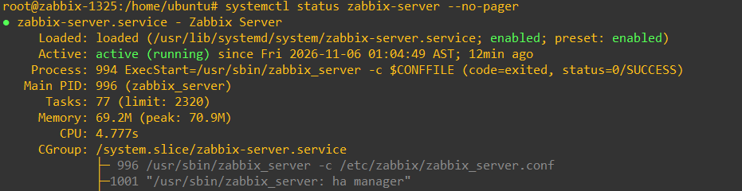

El servicio está **active (running)** y habilitado para arrancar con el sistema.

### 7.5 Asistente web

Desde el Firefox del webterm abrí `http://10.13.25.21/zabbix` y completé el asistente:

| Pantalla | Valor |
|---|---|
| Configure DB connection | MySQL, host `localhost`, base `zabbix`, usuario `Omarpaulino` |
| Settings | Nombre del servidor `ZABBIX-1325`, zona horaria `America/Santo_Domingo` |

En el asistente el host de la base de datos es `localhost` porque quien se conecta a MySQL es la web de Zabbix, que corre en el mismo Ubuntu; el webterm solo muestra la página. Después entré con el usuario `Admin`.

### 7.6 Webterm como cliente DHCP

El webterm es el navegador desde el que abro la web de Zabbix. Su red está configurada en GNS3 (clic derecho, **Edit config**) para pedir IP por DHCP ([`scripts/webterm/network-config.txt`](ZABBIX-SNMP-DHCP/scripts/webterm/network-config.txt)):

```
auto eth0
iface eth0 inet dhcp
```

---

## 8. Agregar el router y el switch en Zabbix

### 8.1 Grupo de hosts

En **Data collection → Host groups → Create host group** creé el grupo `Red-1325`.

### 8.2 Host R1-1325

En **Data collection → Hosts → Create host**:

| Campo | Valor |
|---|---|
| Host name | R1-1325 |
| Templates | Cisco IOS by SNMP |
| Host groups | Red-1325 |
| Interfaces | SNMP, IP `10.13.25.1`, puerto `161` |
| SNMP version | SNMPv2 |
| SNMP community | ZBX1325-RO |
| Description | Router de la LAN 10.13.25.0/24, servidor DHCP |
| Inventory | Automatic |

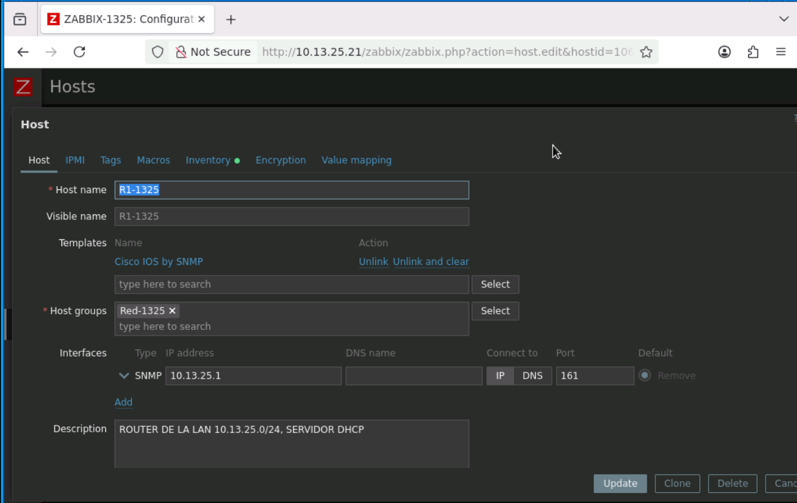

### 8.3 Host SW-1325

| Campo | Valor |
|---|---|
| Host name | SW-1325 |
| Templates | Cisco IOS by SNMP |
| Host groups | Red-1325 |
| Interfaces | SNMP, IP `10.13.25.2`, puerto `161` |
| SNMP version | SNMPv2 |
| SNMP community | ZBX1325-RO |
| Description | Switch de la LAN 10.13.25.0/24 |
| Inventory | Automatic |

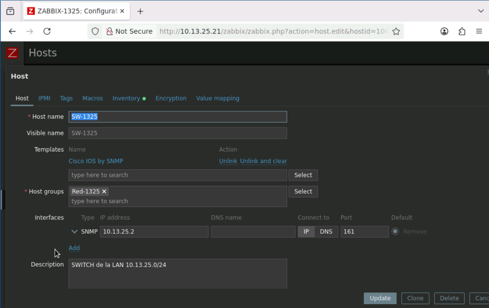

La plantilla **Cisco IOS by SNMP** ya trae la lista de OIDs que hay que consultar (uptime, interfaces, CPU, memoria, temperatura, inventario), así que no tuve que escribir ningún OID a mano. Con **Inventory: Automatic**, Zabbix llena el inventario de cada equipo con los datos que lee por SNMP.

---

## 9. Pruebas y resultados

### 9.1 Clientes DHCP en el router

```
show ip dhcp binding
```

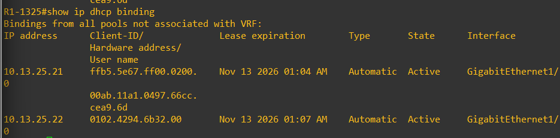

| IP | Client-ID | Equipo |
|---|---|---|
| 10.13.25.21 | `ffb5.5e67.ff00...` (DUID) | ZABBIX-1325. Ubuntu se identifica con un DUID en lugar de la MAC |
| 10.13.25.22 | `0102.4294.6b32.00` | WEBTERM-1325. La MAC empieza con `02:42`, que es el prefijo de los contenedores Docker |

Las dos IPs están dentro del rango que reparte el pool (a partir de `.21`), en estado **Active** y sobre la interfaz Gi1/0.

### 9.2 Lectura SNMP desde el servidor Zabbix

Antes de agregar los hosts en la web, comprobé desde el Ubuntu que podía leer los dos equipos con la comunidad de solo lectura ([`05_pruebas_snmp.sh`](ZABBIX-SNMP-DHCP/scripts/servidor/05_pruebas_snmp.sh)).

```
snmpwalk -v2c -c ZBX1325-RO 10.13.25.1 1.3.6.1.2.1.1
```

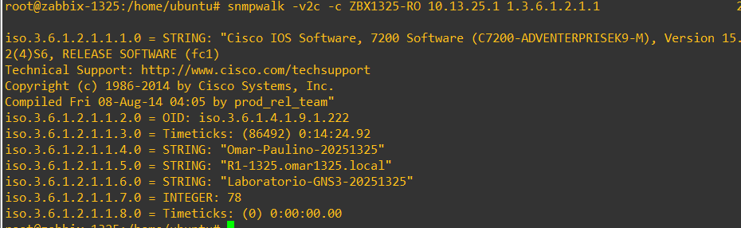

```
snmpwalk -v2c -c ZBX1325-RO 10.13.25.2 1.3.6.1.2.1.1 | head -n 10
```

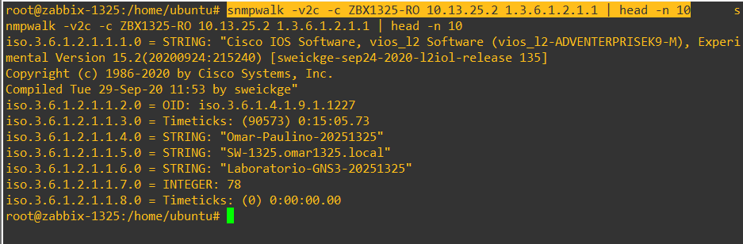

El OID `1.3.6.1.2.1.1` es el grupo **system** de la MIB estándar MIB-II:

| OID | Nombre | Valor en R1-1325 | Valor en SW-1325 |
|---|---|---|---|
| `...1.1.0` | sysDescr | Cisco IOS 7200, versión 15.2(4)S6 | Cisco IOS vios_l2, versión 15.2 |
| `...1.2.0` | sysObjectID | `1.3.6.1.4.1.9.1.222` (Cisco 7206VXR) | `1.3.6.1.4.1.9.1.1227` (IOSvL2) |
| `...1.3.0` | sysUpTime | Tiempo encendido, en centésimas de segundo | Tiempo encendido |
| `...1.4.0` | sysContact | Omar-Paulino-20251325 | Omar-Paulino-20251325 |
| `...1.5.0` | sysName | R1-1325.omar1325.local | SW-1325.omar1325.local |
| `...1.6.0` | sysLocation | Laboratorio-GNS3-20251325 | Laboratorio-GNS3-20251325 |
| `...1.7.0` | sysServices | 78 (capas 2, 3, 4 y 7) | 78 |

Los valores de `contact` y `location` son los que configuré con `snmp-server`.

### 9.3 La comunidad es de solo lectura

Intenté cambiar el nombre del router por SNMP (`sysName`, OID `1.3.6.1.2.1.1.5.0`) con la misma comunidad:

```
snmpset -v2c -c ZBX1325-RO 10.13.25.1 1.3.6.1.2.1.1.5.0 s PRUEBA
```

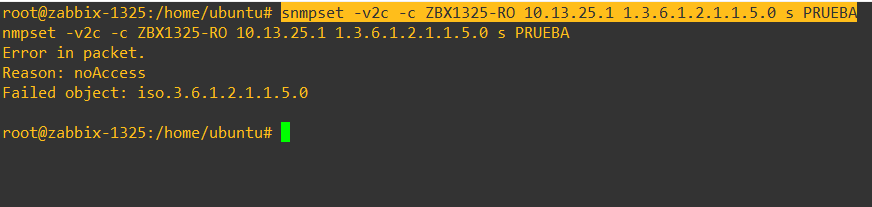

El router responde **`noAccess`**: con la comunidad `ZBX1325-RO` se puede leer el equipo, pero no modificarlo.

### 9.4 Hosts con SNMP disponible en Zabbix

En **Monitoring → Hosts**, R1-1325 y SW-1325 tienen la etiqueta **SNMP en verde**, que indica que Zabbix se está comunicando con ellos por SNMP. El host *Zabbix server* aparece en verde con **ZBX**, porque se monitorea con su propio agente.

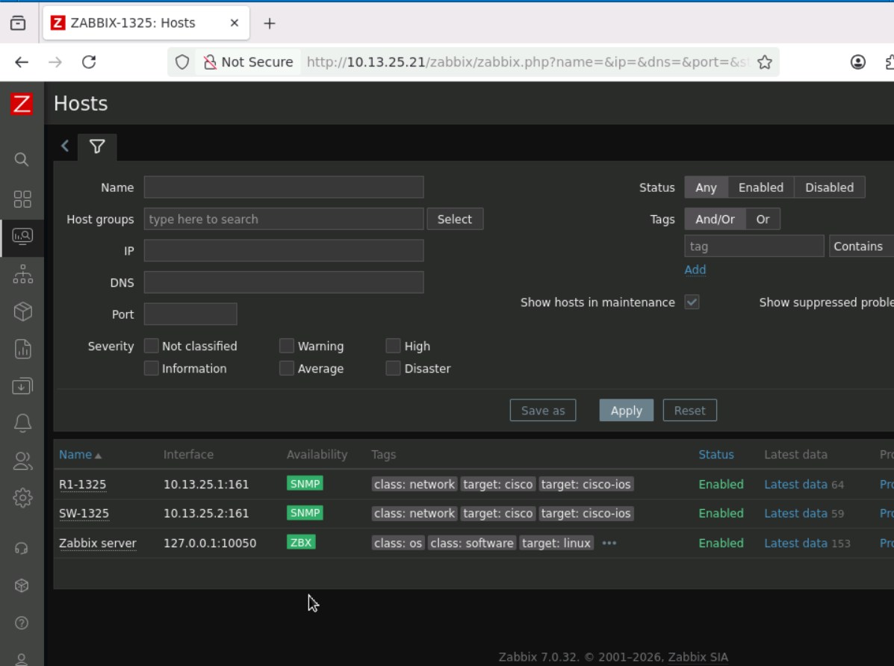

### 9.5 Datos SNMP del router

En **Monitoring → Latest data**, filtrando por R1-1325:

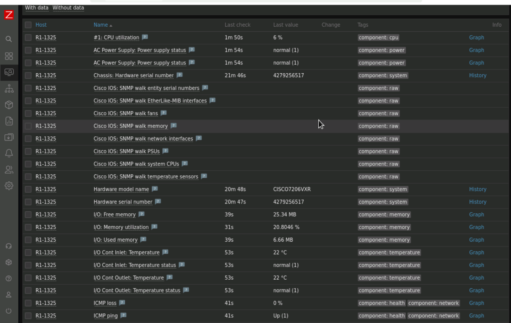

| Dato | Valor |
|---|---|
| CPU utilization | 6 % |
| Power supply status | normal |
| Hardware model name | CISCO7206VXR |
| Hardware serial number | 4279256517 |
| Memoria libre / usada | 25.34 MB / 6.66 MB (20.8 %) |
| Temperatura de entrada y salida | 22 °C, normal |
| ICMP ping / loss | Up / 0 % |

Y el estado y el tráfico de cada interfaz. Por ejemplo, Gi1/0 (`LAN-1325-HACIA-SW-1325`) con su tráfico de entrada y salida, `fullDuplex`, estado `up` y velocidad de 1 Gbps:

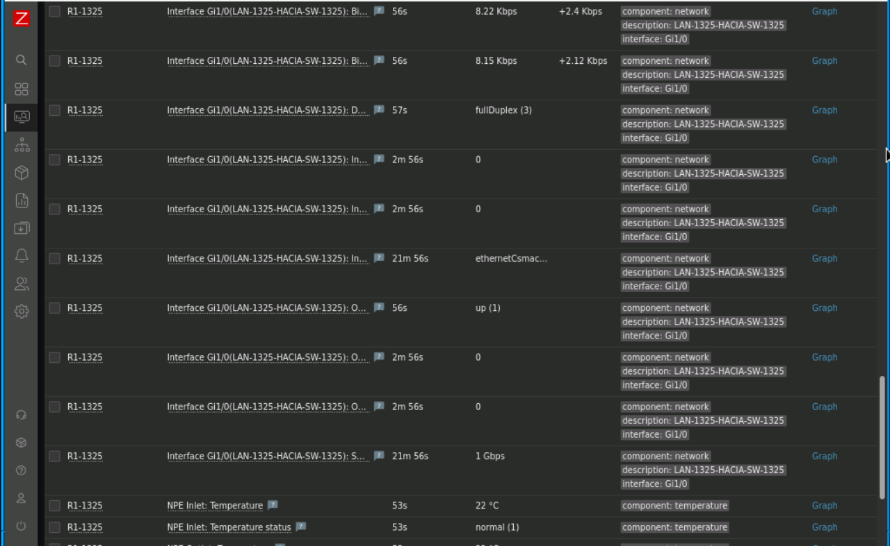

### 9.6 Datos SNMP del switch

En **Monitoring → Latest data**, filtrando por SW-1325:

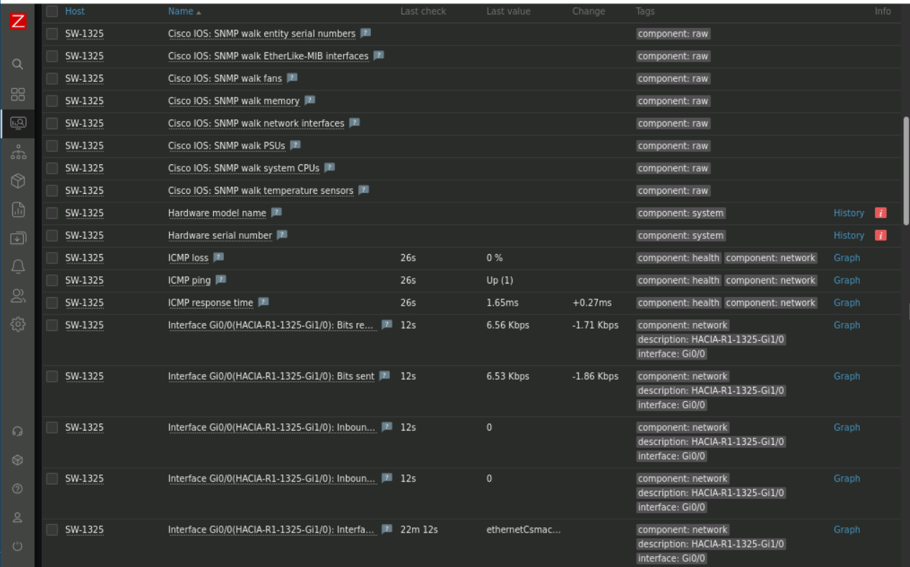

Se ven la disponibilidad (ICMP ping Up, 0 % de pérdida, 1.65 ms de respuesta) y el tráfico de cada interfaz, con la descripción configurada en el switch: Gi0/0 hacia el router, Gi0/2 hacia el webterm y la interfaz de gestión Vl13.

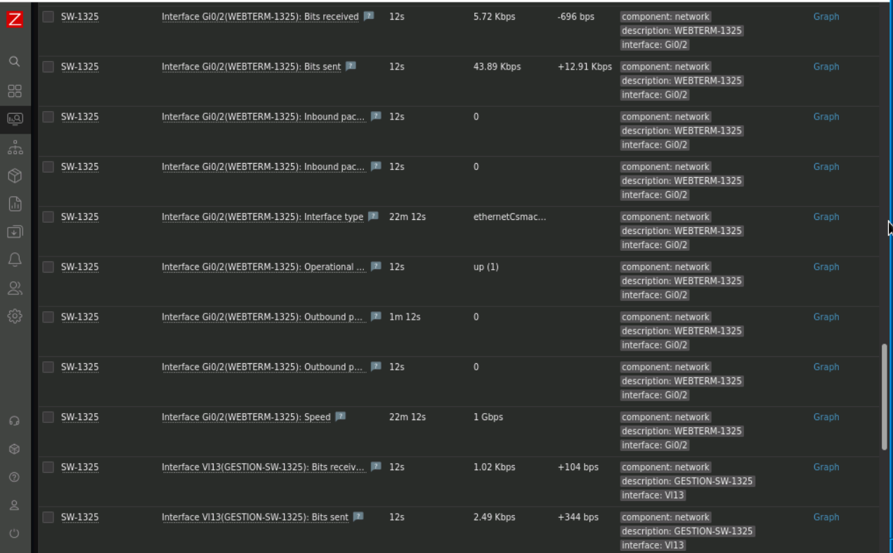

Los items *Hardware model name* y *Hardware serial number* del switch aparecen con el icono rojo de *no soportado*, igual que *Operating system*:

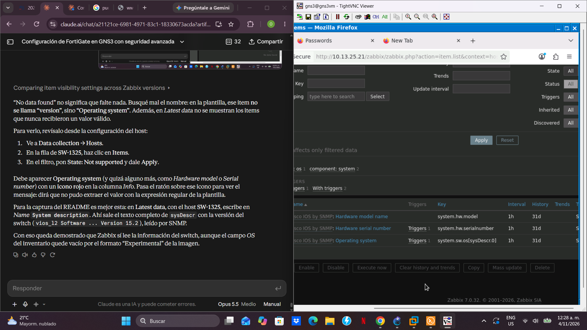

Esto se debe a la imagen. El router corre en Dynamips, que emula el hardware de un 7206VXR físico, y publica por SNMP el modelo y el serial de ese chasis emulado. El switch es una imagen virtual nativa (IOSvL2) que no simula ningún chasis, así que no publica modelo ni serial. Además, su texto de versión ("Experimental Version 15.2(20200924:215240)") no encaja en el formato que la plantilla usa para extraer el sistema operativo. El resto de los datos del switch (disponibilidad, interfaces, tráfico, estado de los puertos) sí se reciben por SNMP.

### 9.7 Gráficas

Zabbix guarda el historial de cada valor y genera gráficas automáticamente.

**Router R1-1325:** CPU, memoria y temperatura.

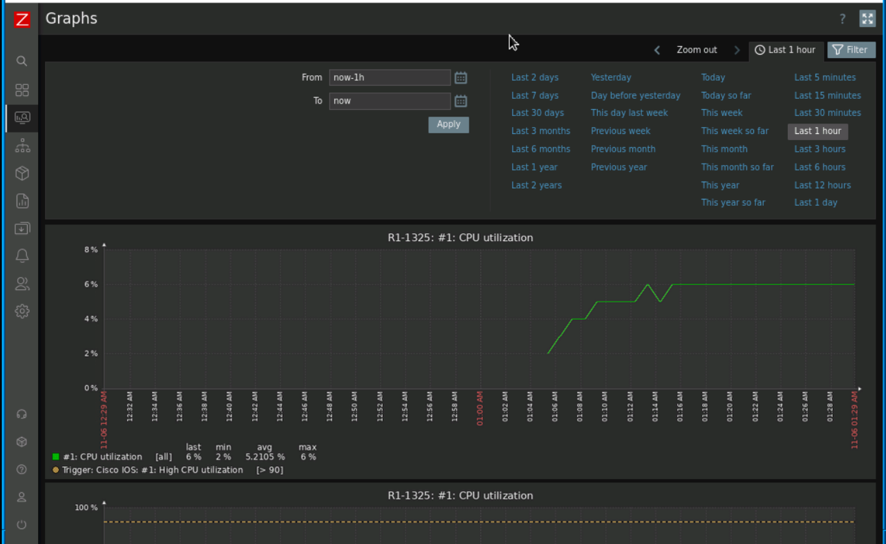

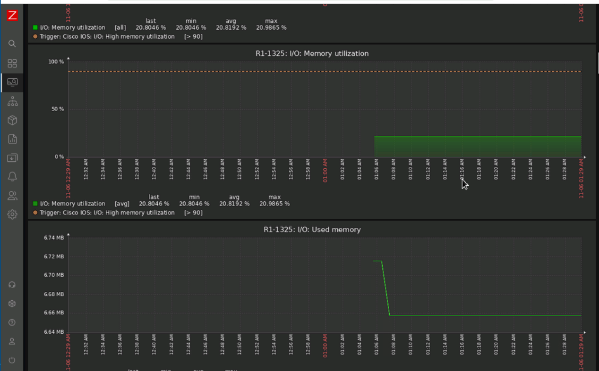

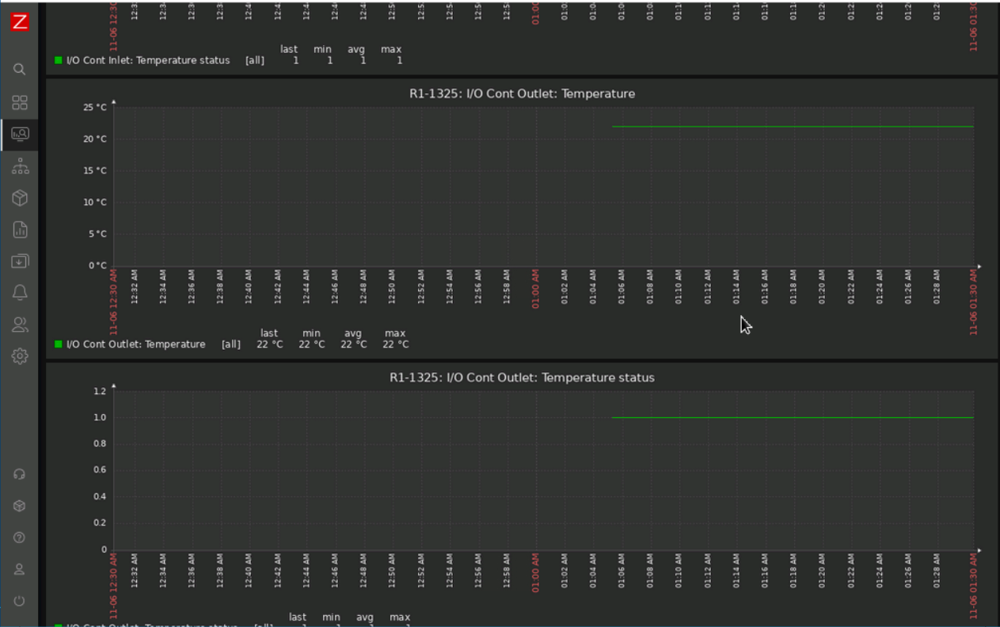

**Switch SW-1325:** tiempo de respuesta y tráfico de Gi0/0, el enlace hacia el router.

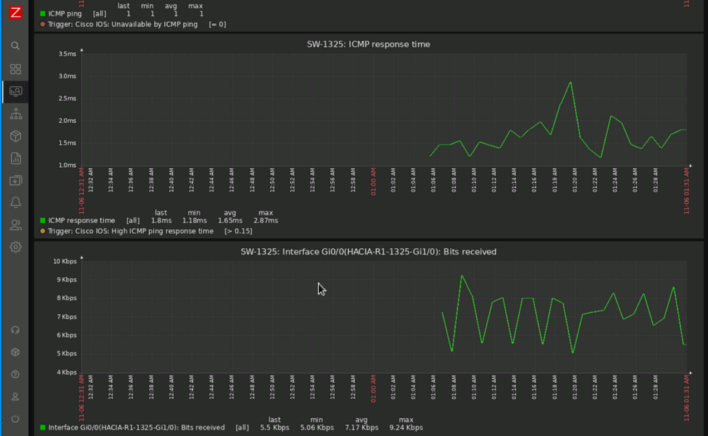

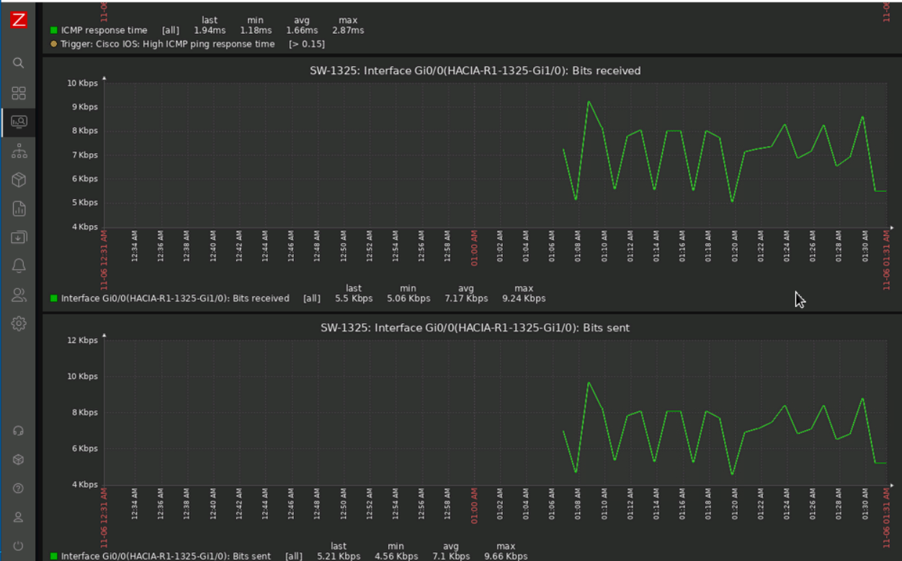

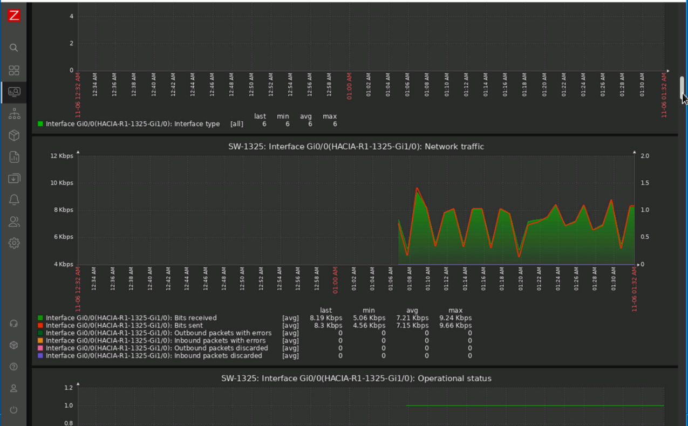

En la gráfica *Network traffic* de Gi0/0 se ven juntos los bits recibidos y enviados, y los paquetes con errores y descartados, que están en 0.

### 9.8 Inventario

En **Inventory → Hosts**, Zabbix llenó el inventario de cada equipo con los datos leídos por SNMP:

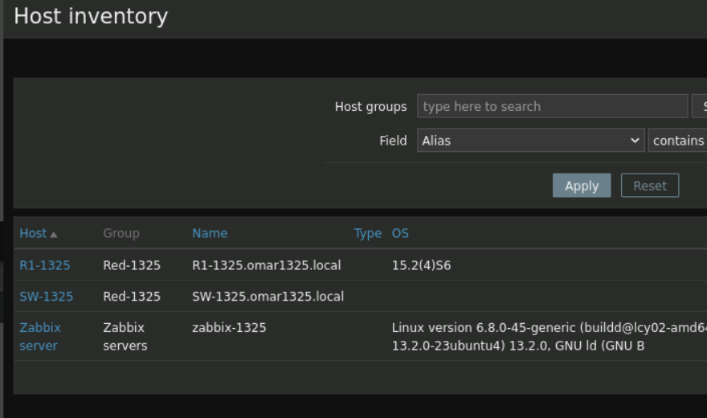

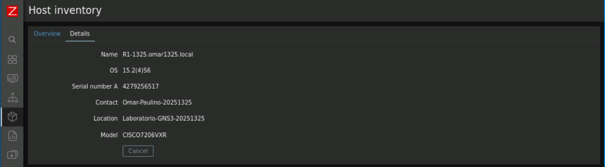

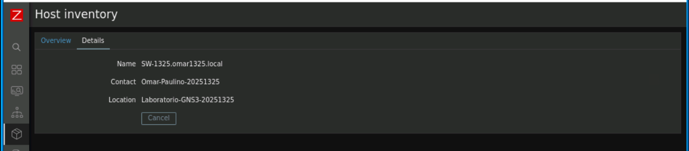

| Campo | R1-1325 | SW-1325 |
|---|---|---|
| Name | R1-1325.omar1325.local | SW-1325.omar1325.local |
| OS | 15.2(4)S6 | No publicado por la imagen |
| Serial number | 4279256517 | No publicado por la imagen |
| Contact | Omar-Paulino-20251325 | Omar-Paulino-20251325 |
| Location | Laboratorio-GNS3-20251325 | Laboratorio-GNS3-20251325 |
| Model | CISCO7206VXR | No publicado por la imagen |

### 9.9 Resumen de resultados

| Prueba | Resultado |
|---|---|
| El router reparte IPs por DHCP en la LAN | Sí: ZABBIX-1325 (`.21`) y WEBTERM-1325 (`.22`) en `show ip dhcp binding` |
| El servidor Zabbix es cliente DHCP | Sí: `dynamic` en `ip a` y `dhcp4: true` en netplan |
| El router responde por SNMP | Sí: `snmpwalk` y Zabbix con SNMP en verde |
| El switch responde por SNMP | Sí: `snmpwalk` y Zabbix con SNMP en verde |
| La comunidad es de solo lectura | Sí: `snmpset` rechazado con `noAccess` |
| Zabbix muestra los datos del router | Sí: CPU, memoria, temperatura, interfaces, gráficas e inventario |
| Zabbix muestra los datos del switch | Sí: disponibilidad, interfaces, tráfico, gráficas e inventario |

---

## 10. Running-configs y scripts

### Running-configs

| Archivo | Equipo |
|---|---|
| [`R1-1325_running-config.txt`](ZABBIX-SNMP-DHCP/running-configs/R1-1325_running-config.txt) | Router R1-1325 (`show running-config`) |
| [`SW-1325_running-config.txt`](ZABBIX-SNMP-DHCP/running-configs/SW-1325_running-config.txt) | Switch SW-1325 (`show running-config`) |
| [`zabbix_server.conf`](ZABBIX-SNMP-DHCP/running-configs/zabbix_server.conf) | Configuración del servidor Zabbix, sin comentarios |
| [`netplan_zabbix-1325.yaml`](ZABBIX-SNMP-DHCP/running-configs/netplan_zabbix-1325.yaml) | Configuración de red del Ubuntu (cliente DHCP) |

### Scripts

| Archivo | Descripción |
|---|---|
| [`router/R1-1325_configuracion.txt`](ZABBIX-SNMP-DHCP/scripts/router/R1-1325_configuracion.txt) | Configuración completa del router |
| [`switch/SW-1325_configuracion.txt`](ZABBIX-SNMP-DHCP/scripts/switch/SW-1325_configuracion.txt) | Configuración completa del switch |
| [`servidor/01_verificar_dhcp.sh`](ZABBIX-SNMP-DHCP/scripts/servidor/01_verificar_dhcp.sh) | Comprobación del cliente DHCP y preparación del Ubuntu |
| [`servidor/02_instalar_zabbix.sh`](ZABBIX-SNMP-DHCP/scripts/servidor/02_instalar_zabbix.sh) | Repositorio y paquetes de Zabbix |
| [`servidor/03_base_de_datos.sql`](ZABBIX-SNMP-DHCP/scripts/servidor/03_base_de_datos.sql) | Base de datos y usuario de MySQL |
| [`servidor/04_configurar_e_iniciar.sh`](ZABBIX-SNMP-DHCP/scripts/servidor/04_configurar_e_iniciar.sh) | Esquema, conexión a la base de datos e inicio de servicios |
| [`servidor/05_pruebas_snmp.sh`](ZABBIX-SNMP-DHCP/scripts/servidor/05_pruebas_snmp.sh) | Pruebas SNMP contra el router y el switch |
| [`webterm/network-config.txt`](ZABBIX-SNMP-DHCP/scripts/webterm/network-config.txt) | Configuración de red del webterm (DHCP) |
| [`pruebas_router_switch.txt`](ZABBIX-SNMP-DHCP/scripts/pruebas_router_switch.txt) | Comandos de verificación usados en el router y el switch |
